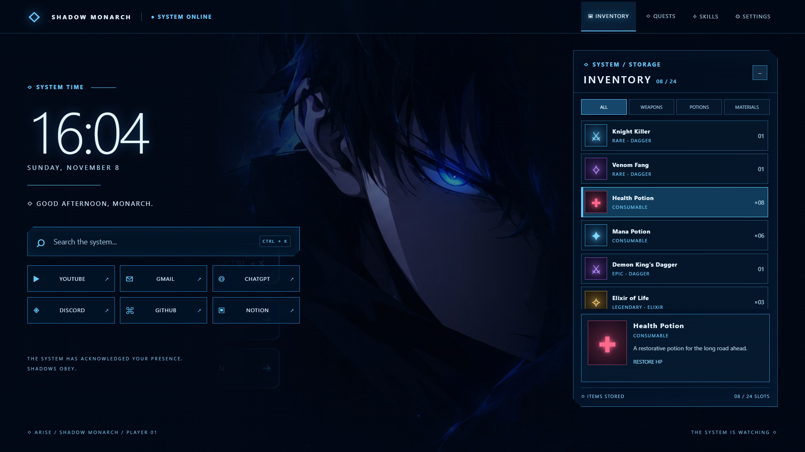
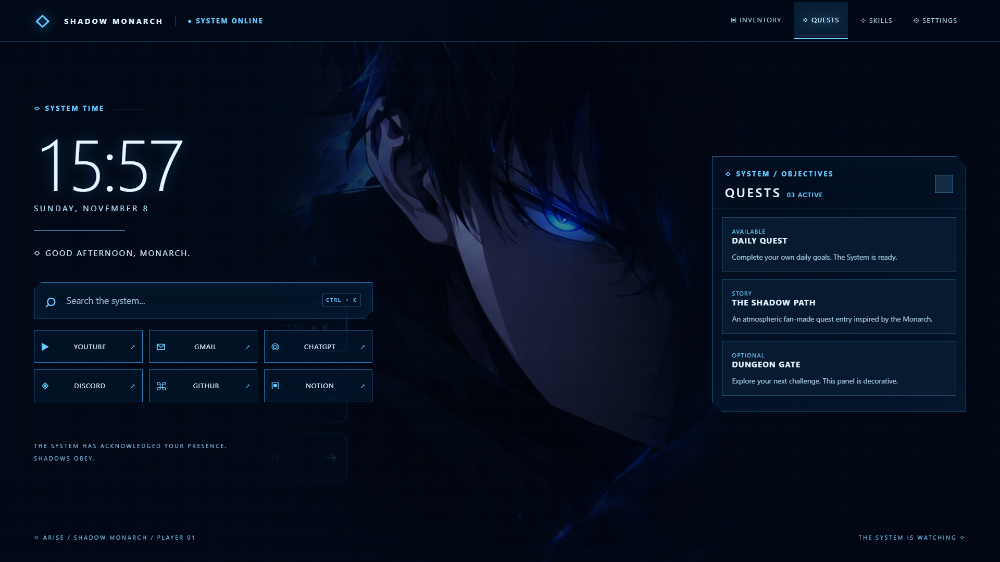
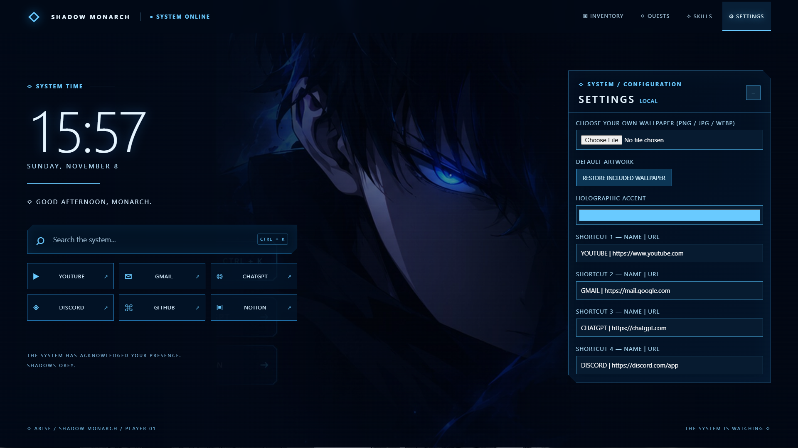
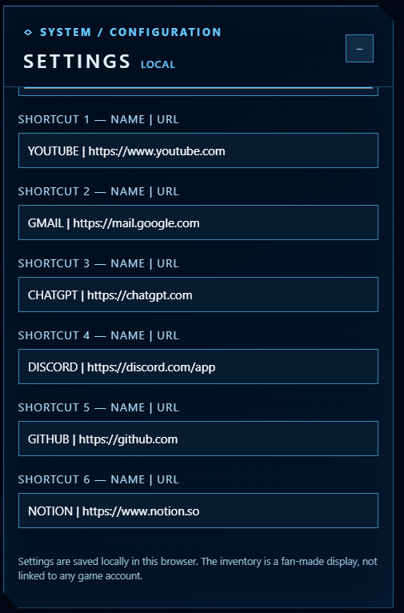

SHADOW MONARCH V4 - ARISE
==========================
INSTALLATION IN HELIUM
1. Extract the ZIP into a permanent folder (not inside the ZIP viewer).
2. Open chrome://extensions in Helium.
3. Disable or remove the old Shadow Monarch new-tab extension (and Bonjourr if still active).
4. Enable Developer mode and choose Load unpacked.
5. Select the extracted shadow-monarch-v4 folder containing manifest.json.
6. Open a new tab.

FEATURES
- Clock/date and greeting update automatically.
- Search uses Google. Ctrl+K focuses search.
- Six shortcuts; change their names and HTTPS URLs in Settings using NAME | https://example.com.
- Inventory is scrollable and filterable; click items for details.
- Quests and Skills are atmospheric fan-made panels.
- Settings lets you choose your own PNG/JPG/WEBP wallpaper (under 8 MB), restore the included artwork, and change the accent color.
- Settings are stored locally in this browser; no account or external services needed for the dashboard.
- Inventory and quest stats are decorative, not connected to a game.

The included background is an atmospheric crop of the approved visual concept, with side HUD elements excluded. Replace it in Settings with any wallpaper you prefer.

